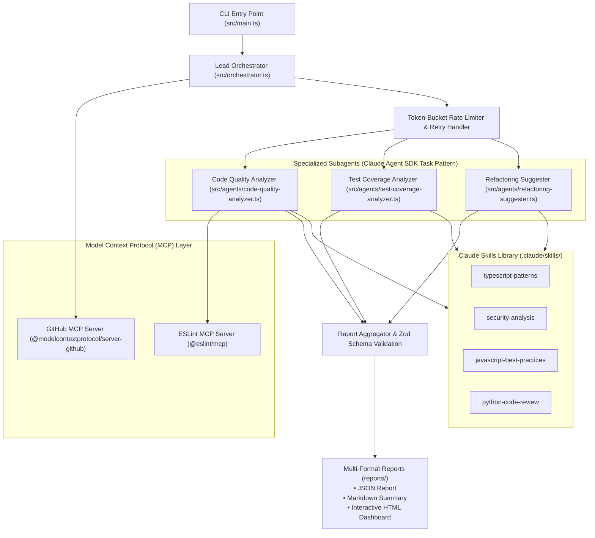

# Enterprise Multi-Agent Code Review Orchestrator 🚀

[](https://www.typescriptlang.org/)
[](https://github.com/anthropics/claude-agent-sdk)
[](https://modelcontextprotocol.io/)
[](https://vitest.dev/)
[](https://zod.dev/)

An enterprise-ready, multi-agent automated code review orchestrator built using the **Claude Agent SDK** and **Model Context Protocol (MCP)**. It coordinates specialized subagents to perform in-depth code quality checks, security vulnerability detection, test coverage gap analysis, and architectural refactoring recommendations on GitHub pull requests.

---

## 🏛️ System Architecture



---

## ✨ Key Features

### 1. Multi-Agent Orchestration via Claude Agent SDK
* Implements the **Task tool orchestration pattern** registering subagents dynamically.
* Runs specialized subagents concurrently across modified files with managed rate limits and backoff retries.

### 2. Specialized Subagents
| Agent | Role | Focus Areas | Tools |
| :--- | :--- | :--- | :--- |
| **Code Quality Analyzer** | Vulnerability & Code Smell Detection | OWASP Top 10, static analysis, performance, maintainability, type safety | `Skill`, `Read`, `Grep`, `Glob`, `mcp__eslint__lint` |
| **Test Coverage Analyzer** | Coverage Gap & Edge Case Discovery | Missing tests, untraced branches, boundary values, error recovery paths | `Skill`, `Read`, `Grep`, `Glob` |
| **Refactoring Suggester** | Architecture Modernization | Pattern improvements, function extraction, simplification, modern syntax | `Skill`, `Read`, `Grep`, `Glob` |

### 3. Domain-Specific Claude Skills Library
* **`typescript-patterns`**: Strict typing, discriminated unions, type narrowing, avoiding `any`, utility types.
* **`security-analysis`**: Defenses against injection (SQL, NoSQL, command), XSS, broken authentication, IDOR.
* **`python-code-review`**: PEP 8 compliance, idiomatic generators/comprehensions, context managers, type hinting.
* **`javascript-best-practices`**: Async/await paradigms, modern ES2022+ features, memory leak prevention.

### 4. Model Context Protocol (MCP) Integration
* **GitHub MCP Server**: Pull request metadata retrieval, patch parsing, file tree exploration.
* **ESLint MCP Server**: Automated static code linting and style compliance checks.

### 5. Production Reliability & Guardrails
* **Token-Bucket Rate Limiter**: Sliding 60-second window tracking requests and token consumption with concurrent slot management.
* **Error Resilience**: Configurable exponential backoff with randomized jitter and `Promise.race` timeout wrappers.
* **Type-Safe Validation**: Runtime validation on all agent outputs and aggregated reports using **Zod** and JSON Schema.

---

## 📁 Project Structure

```
├── .claude/
│   └── skills/                         # Reusable Claude domain knowledge
│       ├── javascript-best-practices/
│       ├── python-code-review/
│       ├── security-analysis/
│       └── typescript-patterns/
├── src/
│   ├── agents/                         # Subagent definitions & execution runners
│   │   ├── code-quality-analyzer.ts
│   │   ├── test-coverage-analyzer.ts
│   │   ├── refactoring-suggester.ts
│   │   └── index.ts
│   ├── config/
│   │   └── mcp.config.ts               # Stdio MCP configuration (GitHub & ESLint)
│   ├── prompts/                        # Centralized system prompts
│   │   ├── orchestrator.prompt.ts
│   │   ├── code-quality-analyzer.prompt.ts
│   │   ├── test-coverage-analyzer.prompt.ts
│   │   └── refactoring-suggester.prompt.ts
│   ├── types/                          # Zod schemas & TypeScript definitions
│   │   ├── analysis-results.ts
│   │   ├── report-types.ts
│   │   └── index.ts
│   ├── utils/                          # Production logging, rate limiting & retries
│   │   ├── error-handler.ts
│   │   ├── logger.ts
│   │   ├── rate-limiter.ts
│   │   └── report-generator.ts
│   ├── orchestrator.ts                 # Main coordinator engine
│   └── main.ts                         # CLI entry point
├── tests/
│   └── orchestrator.test.ts            # Vitest unit test suite
├── reports/                            # Generated PR review deliverables
├── package.json
└── tsconfig.json
```

---

## 🚀 Getting Started

### Prerequisites
* **Node.js** 18+ (tested on Node v20/v23)
* **Anthropic API Key** (or AWS Bedrock credentials)
* **GitHub Personal Access Token** *(optional, for higher rate limits on public/private repositories)*

### Installation

```bash
# Clone the repository
git clone https://github.com/vani-rajana/enterprise-multiagent-code-review.git
cd enterprise-multiagent-code-review

# Install dependencies
npm install

# Copy environment configuration
cp .env.example .env
```

### Configuration (`.env`)

```env
# Choose Authentication Method:
ANTHROPIC_API_KEY=sk-ant-your-api-key-here

# Required Model:
ANTHROPIC_MODEL=claude-sonnet-4-5-20250929

# Absolute path to project directory (contains .claude/skills/):
PROJECT_ROOT=/path/to/project

# Optional GitHub Token:
GITHUB_TOKEN=ghp_your_token_here

# Logging level:
LOG_LEVEL=info
```

---

## 💻 Usage

### Run a Code Review via CLI

```bash
# Development mode
npm run dev -- <owner> <repo> <pr-number>

# Example: Review PR #1 in octocat/Hello-World
npm run dev -- octocat Hello-World 1
```

### Production Build & Execution

```bash
# Compile TypeScript to dist/
npm run build

# Run compiled application
npm start <owner> <repo> <pr-number>
```

---

## 🧪 Testing

The repository includes a comprehensive test suite using **Vitest**:

```bash
# Run all unit tests
npm test

# Run tests in watch mode
npm run test:watch
```

---

## 📊 Sample Output Reports

When a pull request review completes, the orchestrator outputs three rich report formats into the `reports/` directory:

1. **Markdown (`.md`)**: Ready to be posted directly as a GitHub PR comment.
2. **HTML Dashboard (`.html`)**: Interactive report with visual metric cards, severity badges, and recommendation filters.
3. **Structured JSON (`.json`)**: Machine-readable data matching `ReviewReportSchema` for CI/CD integration.

---

## 🛡️ License

This project is licensed under the **ISC License**.
